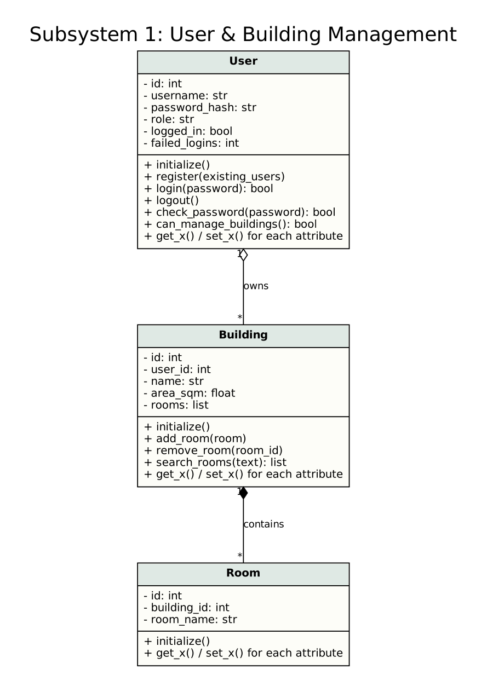
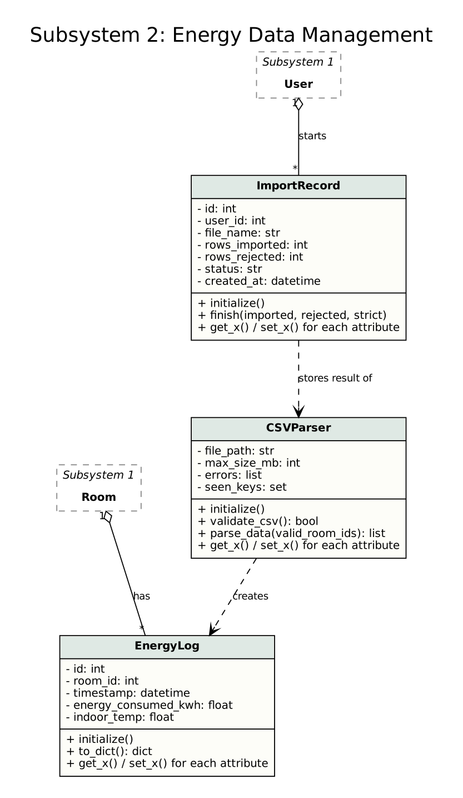
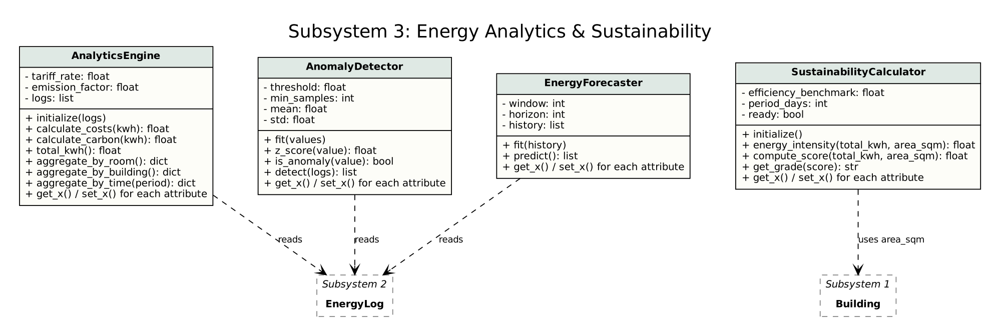
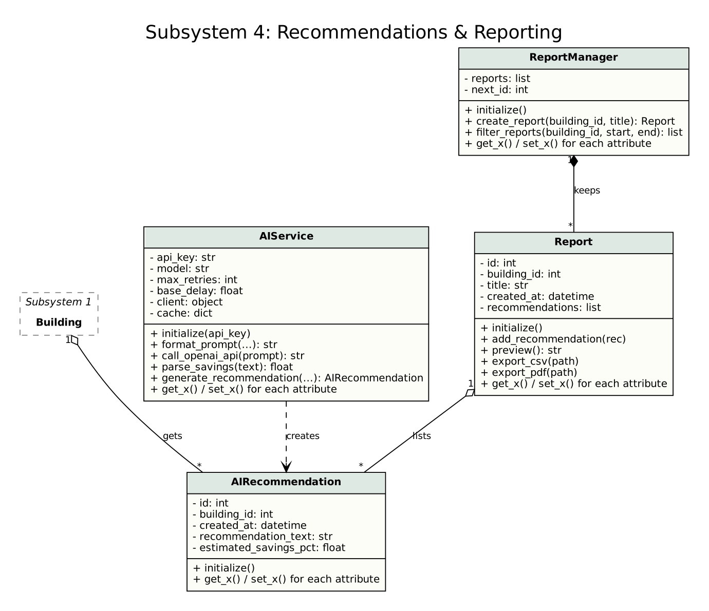

# AI-Powered Smart Energy Management System (EcoPulse)

FH Dortmund · Master's Capstone Project (MDT 7226) · Group 5

A web-based platform that helps buildings such as universities, offices and homes use less energy. The system predicts energy demand, detects abnormal consumption and recommends energy-saving actions. It also tracks electricity cost, CO₂ emissions and a sustainability score for each building.

---

## 1. Team Overview

Here is the corrected and properly formatted Markdown table:

| Member | Student ID | Subsystem | Scope |
| --- | --- | --- | --- |
| Thi Ha Vu | MDT 7226574 | 1 · User & Building Management | FR01, FR02 |
| S M Saifur Rahman | MDT 7226434 | 2 · Energy Data Management | FR03–FR05 |
| Md. Ahad Ali | MDT 7226162 | 3 · Energy Analytics & Sustainability | FR06–FR08 |
| MD Sakib Khan | MDT 7225912 | 4 · Recommendations & Reporting | FR09, FR10 |

Each member implements at least 3 classes for their own subsystem. Every class has a constructor, an initialization method , and getter and setter methods.

---

## 2. System Design

The diagrams below show the classes of each subsystem. Solid lines with a diamond mean ownership (1 to many). Dashed arrows mean that one class uses another. A dashed box marks a class that belongs to another subsystem.

The `.dot` source of every diagram is in [`docs/uml/`](docs/uml/). Run `python docs/uml/make_uml.py` to build the PNG files again (needs [Graphviz](https://graphviz.org/)).

### Subsystem 1: User & Building Management

Owner: Thi Ha Vu



### Subsystem 2: Energy Data Management

Owner: S M Saifur Rahman



### Subsystem 3: Energy Analytics & Sustainability

Owner: Md. Ahad Ali



### Subsystem 4: Recommendations & Reporting

Owner: MD Sakib Khan



---

## Repository Structure

```
.
├── README.md
├── src/
│   ├── subsystem1_user_building.py
│   ├── subsystem2_energy_data.py
│   ├── subsystem3_analytics.py
│   └── subsystem4_recommendations.py
└── docs/
    └── uml/
        ├── make_uml.py
        ├── subsystem1.dot / .png
        ├── subsystem2.dot / .png
        ├── subsystem3.dot / .png
        └── subsystem4.dot / .png
```

## How to Run

Each file has a short demo at the bottom. Python 3.8 or newer is enough, with no extra packages.

```bash
python src/subsystem1/main.py
python src/subsystem2_energy_data.py
python src/subsystem3_analytics.py
python src/subsystem4_recommendations.py
```
