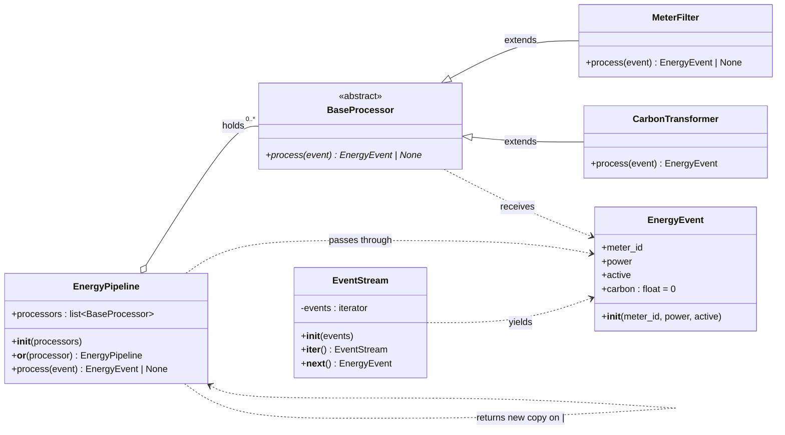
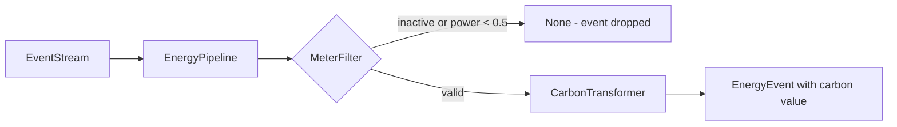
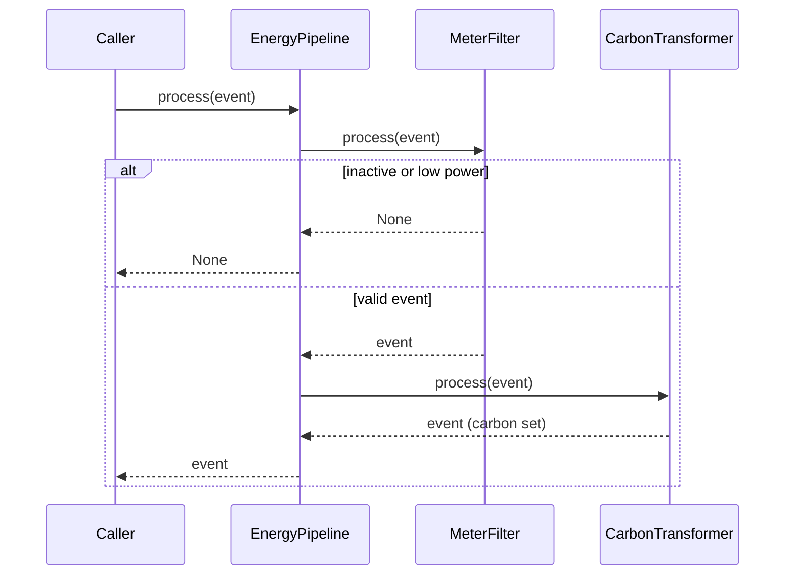

# Energy Pipeline
***Video: https://drive.google.com/drive/folders/1Ho6cv0odCKdPfS4sHJSkIUMwoBazxItP?usp=drive_link ***

A small Python library that reads smart meter events, filters out noise, and calculates the carbon emissions of each event.

The design uses the **pipeline pattern**. Each step is a processor. The pipeline passes every event through its processors in order. Any processor can drop an event.

## Project Structure

```
.
├── event_stream.py              # EventStream
├── energy_event.py              # EnergyEvent
├── energy_pipeline.py           # EnergyPipeline
└── processors/
    ├── base_processor.py        # BaseProcessor (abstract)
    ├── meter_filter.py          # MeterFilter
    └── carbon_transformer.py    # CarbonTransformer
```

## Class Diagram



## Class Responsibilities

| Class | Role |
|---|---|
| `EnergyEvent` | Data object. It holds one meter reading and the calculated carbon value. |
| `EventStream` | Iterator wrapper. It gives events to the caller one at a time. |
| `EnergyPipeline` | Runs the processors in order. It supports the `\|` operator to chain steps. |
| `BaseProcessor` | Abstract contract. Every processor must implement `process(event)`. |
| `MeterFilter` | Drops inactive meters and events with power below 0.5. |
| `CarbonTransformer` | Sets `event.carbon = power × hours × 0.35`. |

## Processing Flow



## Sequence for One Event



## Usage

```python
from energy_event import EnergyEvent
from energy_pipeline import EnergyPipeline
from event_stream import EventStream
from processors.meter_filter import MeterFilter
from processors.carbon_transformer import CarbonTransformer

pipeline = EnergyPipeline() | MeterFilter() | CarbonTransformer()

events = [
    EnergyEvent("M1", 2.0, True),    # kept, carbon = 0.70
    EnergyEvent("M2", 0.2, True),    # dropped, power too low
    EnergyEvent("M3", 5.0, False),   # dropped, meter inactive
]

for event in EventStream(events):
    result = pipeline.process(event)
    if result is not None:
        print(result.meter_id, result.carbon)
```
